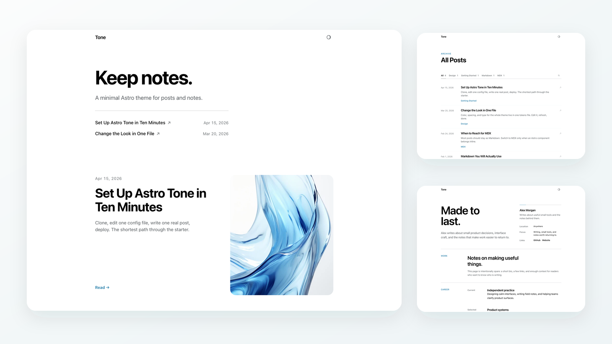
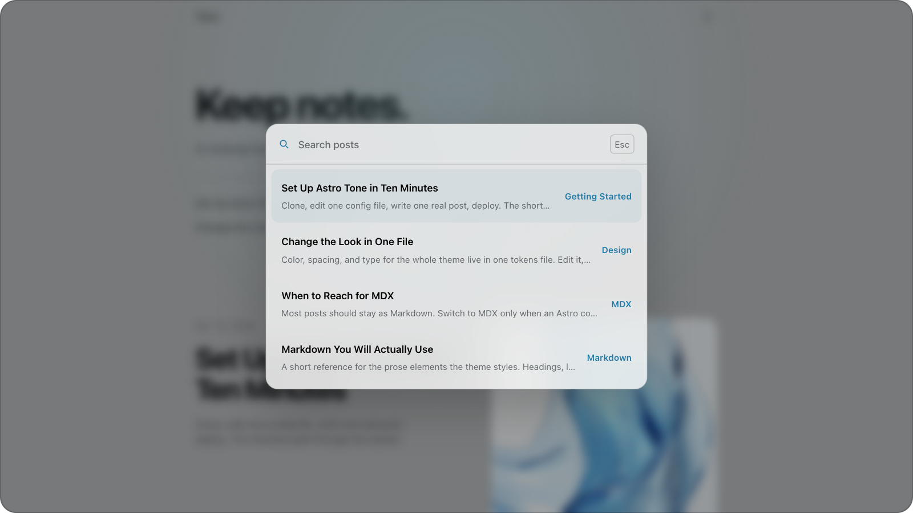
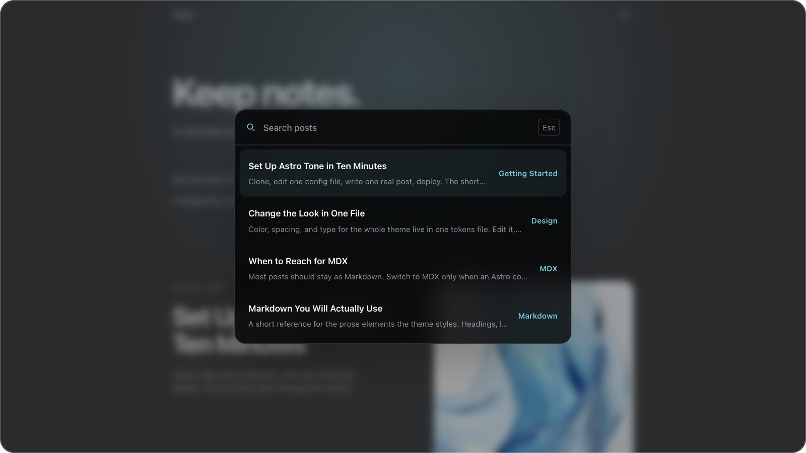

# Tone

Minimal Astro blog starter with quiet defaults.

<p>
  <a href="https://hanityx.github.io/astro-tone/">Live demo</a> ·
  <a href="https://github.com/new?template_name=astro-tone&template_owner=hanityx">Use this template</a>
</p>



## Command Palette

Open quick post search with `Cmd`/`Ctrl` + `K`.

<p>
  
  
</p>

## Features

- Responsive Astro 6 static site
- Markdown and MDX posts in `src/content/posts`
- Posts index with category filters and inline list search
- `/search` route powered by Pagefind
- `Cmd`/`Ctrl` + `K` command palette for quick post search
- Dark mode with CSS tokens
- Custom code block theme via Expressive Code
- Related posts, RSS, sitemap, Open Graph metadata, and JSON-LD
- Optional giscus comments, disabled by default
- Optional `focusEffect: 'scroll-dark'` for long-form posts

<details>
<summary>Performance Snapshot</summary>

Measured with Lighthouse 12.8.2 against a local production preview on May 20, 2026. Treat these as a reproducible baseline, not a permanent hosted score.

| Surface | Mode    | Performance | Accessibility | Best Practices | SEO | FCP    | LCP    | CLS | TBT  |
| ------- | ------- | ----------- | ------------- | -------------- | --- | ------ | ------ | --- | ---- |
| Home    | Mobile  | 100         | 100           | 100            | 100 | 830 ms | 981 ms | 0   | 0 ms |
| Home    | Desktop | 100         | 100           | 100            | 100 | 228 ms | 249 ms | 0   | 0 ms |
| Post    | Mobile  | 100         | 100           | 100            | 100 | 1.21 s | 1.36 s | 0   | 0 ms |
| Post    | Desktop | 100         | 100           | 100            | 100 | 349 ms | 372 ms | 0   | 0 ms |

Additional local measurements:

- Home transfer size: 145 KiB mobile, 152 KiB desktop
- Post transfer size: 44 KiB mobile, 48 KiB desktop
- Cumulative Layout Shift: `0` on all measured pages
- Total Blocking Time: `0 ms` on all measured pages
- Static output: 9 pages in the current sample set
- Pagefind index: 4 pages, 828 words

Reproduce locally:

```bash
npm run build
npm run preview -- --host 127.0.0.1 --port 4321
npx lighthouse http://127.0.0.1:4321/ --output=json
npx lighthouse http://127.0.0.1:4321/ --preset=desktop --output=json
```

</details>

## Quick Start

Requires Node.js 22.12.0 or newer.

Create with the Astro CLI:

```bash
npm create astro@latest astro-tone -- --template hanityx/astro-tone
cd astro-tone
npm run dev
```

Or clone it directly:

```bash
git clone https://github.com/hanityx/astro-tone.git
cd astro-tone
npm install
npm run dev
```

The local dev server usually starts at `http://localhost:4321`.

Before publishing your own site, update `astro-theme-config.ts`, replace the
sample content and assets, then run `npm run check`, `npm run lint`,
`npm run lint:css`, and `npm run build`.

## Commands

| Command            | Action                                         |
| ------------------ | ---------------------------------------------- |
| `npm run dev`      | Start the local dev server                     |
| `npm run build`    | Build the site and generate the Pagefind index |
| `npm run preview`  | Preview the production build                   |
| `npm run check`    | Run Astro type checks                          |
| `npm run lint`     | Run ESLint                                     |
| `npm run lint:css` | Run Stylelint                                  |
| `npm run format`   | Format source files with Prettier              |

## Travelog URL pre-commit hook

Dependency installation enables the repository's pre-commit hook automatically
(except in CI). To enable it manually, run `pnpm hooks:install`.

On commit, staged Markdown and MDX files under `src/content/` have
`https://cdn.iqfareez.com/t/Travelog/` replaced with
`https://r2-fareez-bucket.iqfareez.com/public/Travelog/`. The rest of each URL,
including its filename, is preserved. The hook updates the staged content and
the working copy while keeping unrelated unstaged edits out of the commit.
It requires Node.js on your Git client's PATH.

## Customize

Most site-level settings live in `astro-theme-config.ts`.

The bundled [setup post](src/content/posts/getting-started-v2.md) walks through
configuration, the project structure, writing posts, replacing the samples,
deployment, and optional giscus comments.

## Image groups in Markdown

Wrap one image per paragraph in an `img-grid`. No MDX or imports are needed:

```md
<figure class="image-group">
<div class="img-grid">


</div>
<figcaption>An optional caption for the whole group.</figcaption>
</figure>
```

Keep the blank lines around the Markdown images and between each image so Astro
parses and processes them normally. Local image paths work too; remote hosts must
be allowed by `image.domains` in `astro.config.mjs`.

The layout follows the image count: one keeps its natural proportions, two sit
side by side, three place the first image beside two stacked images, and four form
a 2×2 grid. Larger groups continue in two columns; prefer groups of up to four.
Desktop tiles crop to fit; click or use Enter/Space to see the full image. At
600px and below, images stack with their original proportions.

Remove the `<figcaption>` line to omit the caption. Shared captions also appear
in the zoom preview. You can use just the `<div class="img-grid">` wrapper when
you don't need a figure or caption.

In the zoom preview, groups with multiple images include previous/next buttons
and an image counter. Use the Left/Right arrow keys to navigate too. Navigation
wraps within the current group; standalone images have no navigation controls.

## Deploy

Tone builds as a static site.

| Setting          | Value           |
| ---------------- | --------------- |
| Build command    | `npm run build` |
| Output directory | `dist`          |

The starter supports domain-root deploys and GitHub Pages project paths.

## License

MIT licensed.
